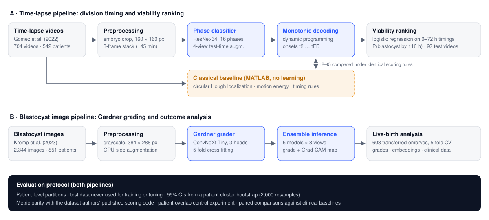
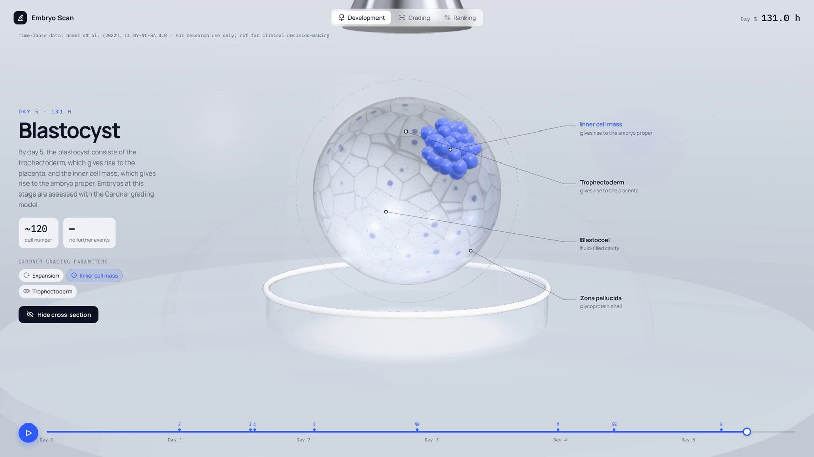
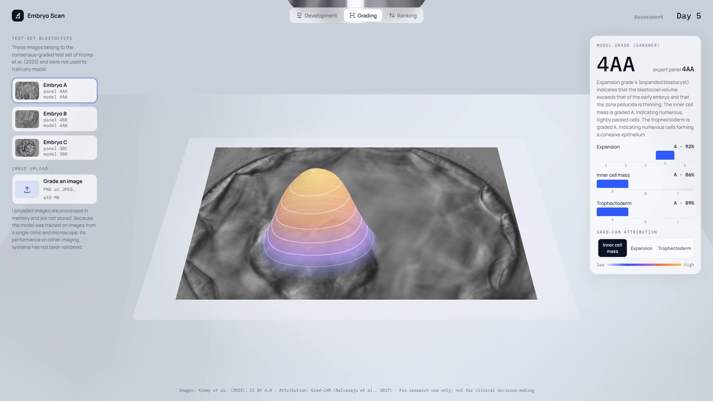
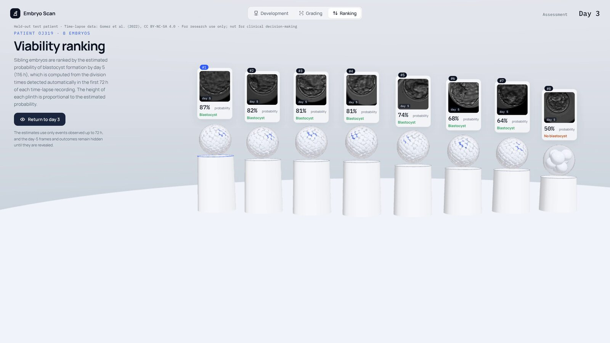

<div align="center">

# Embryo Scan

**Automated morphokinetic annotation, viability ranking and Gardner grading of human IVF embryos from time-lapse video and blastocyst images**

[](https://github.com/cha205/embryo-scan/actions/workflows/ci.yml)
[](LICENSE)
[](pyproject.toml)

[**Interactive demonstrator**](https://embryo-scan.vercel.app) · [**Model weights**](https://huggingface.co/Cfish14/embryo-scan-grader)

</div>

> [!IMPORTANT]
> Embryo Scan is research software. It has not been validated for clinical use, is not a medical device, and must not be used to make treatment decisions.


<sub>**Figure.** Developmental phase of a held-out embryo over five days, as predicted frame by frame (dots), after monotonic decoding (solid) and as annotated by an embryologist (dashed).</sub>

## Overview

Embryo selection in in vitro fertilization (IVF) depends on visual assessment by embryologists. That assessment is labour-intensive and varies between observers. Embryo Scan is an open, end-to-end pipeline that automates three components of the assessment on two public datasets:

1. **Morphokinetic annotation.** A ResNet-34 classifies every frame of a time-lapse recording into one of 16 developmental phases using a three-frame temporal context. A dynamic-programming decoder then enforces monotonic development and yields the division times t2 … tEB.
2. **Viability ranking.** A logistic regression on division times observed up to 72 h ranks embryos by the probability of blastocyst formation by day 5. It is evaluated end to end from raw video and compared with the hierarchical model of Meseguer et al. (2011).
3. **Gardner grading.** A five-model ConvNeXt-Tiny ensemble grades expansion, inner cell mass (ICM) and trophectoderm (TE) on day-5 blastocyst images, with Grad-CAM attribution maps.

The evaluation protocol was designed to rule out over-optimistic results. Every partition created for this work is made at the patient level, every interval is a patient-cluster bootstrap 95% CI, the grading metric was verified against the dataset authors' published values, and a controlled retraining experiment tests whether patient overlap in the official benchmark split inflates accuracy.

## Key results

All results are on held-out data. Test patients in the time-lapse and outcome analyses were never seen in training. The official grading test set shares some patients with the training data, and a control experiment shows that this overlap does not inflate accuracy.

| Task | Test data | Metric | Embryo Scan | Reference |
|---|---|---|---|---|
| Division timing (t2 / t3 / t4) | 141 videos, 108 patients | median absolute error | **0.20 / 0.30 / 0.50 h** | frame interval ≈ 0.25 h |
| Division timing, t2 within 1 h | 141 videos | proportion of videos | **92%** | 44% (classical MATLAB baseline) |
| Viability ranking, end to end | 97 videos | AUC (95% CI) | **0.690** (0.566–0.794) | 0.717 with manual annotations; 0.675 Meseguer categories |
| Gardner grading, EXP / ICM / TE | 300 images, expert panel | accuracy | **0.853 / 0.714 / 0.660** | 0.85 / 0.69 / 0.62 best published; 0.78 / 0.74 / 0.70 individual embryologists |
| Live birth | 603 transferred embryos | AUC (5-fold CV) | 0.557 (automated grade) | 0.533 maternal age; 0.550 embryologist's grade |

**Principal findings.** Early cleavage divisions are timed to within one or two imaging intervals, and rankings computed from automatically detected timings approach those computed from manual annotations. Automated Gardner grading reaches the level of the published benchmark. Neither expert nor automated morphology predicted live birth among transferred embryos, and no model improved significantly on maternal age alone.

## Method



**Time-lapse pipeline.** Each video is cropped around the embryo (the most textured region, averaged over twelve frames) and resized to 160 × 160 px. The input for frame *t* stacks frames *t* − 3, *t* and *t* + 3 (about 45 min apart) as channels, so the network can recognise cells in the course of dividing. A ResNet-34 (`resnet34.a1_in1k`) is trained with class-weighted, label-smoothed cross-entropy and rotation, flip, scale, intensity and blur augmentation. Because development is irreversible, the per-frame log-probabilities are decoded into the most probable non-decreasing phase sequence by dynamic programming, equivalent to Viterbi decoding in a left-to-right model, as in Lau et al. (2019):

$$B_t(c) = \log p_\theta(c \mid \mathbf{x}_t) + \max_{c' \le c} B_{t-1}(c')$$

**Classical baseline.** A training-free MATLAB pipeline locates the embryo with a circular Hough transform, measures frame-to-frame motion energy inside it, and assigns t2–t5 with timing rules from embryology. It is scored with exactly the same rules as the deep model.

**Viability ranking.** Features available by day 3 (onsets t2–t8, the second cell cycle cc2 = t3 − t2, the synchrony s2 = t4 − t3, direct cleavage and reaching eight cells by 72 h) feed an L2-regularized logistic regression. The regression is trained on manual annotations and applied either to annotations or, end to end, to timings detected from frames up to 72 h only.

**Gardner grading.** A ConvNeXt-Tiny backbone (`convnext_tiny.fb_in22k_ft_in1k`) has three heads (expansion 1–5, ICM A–C, TE A–C) and is trained with five-fold patient-level cross-fitting, so every training image receives an out-of-fold prediction. Weights are averaged with an exponential moving average. At inference, probabilities are averaged over five models × eight dihedral views. Rare grade C is addressed with class weights and, optionally, decision thresholds tuned on out-of-fold predictions only.

## Results

### Division timing

Decoded phase accuracy on 141 test videos (58,988 annotated frames) is 0.718 (0.928 within one phase). Errors grow after the eight-cell stage, where blastomeres overlap and transitions are gradual.

| Event | t2 | t3 | t4 | t5 | t6 | t7 | t8 | t9+ | tM | tSB | tB | tEB |
|---|---|---|---|---|---|---|---|---|---|---|---|---|
| Median absolute error (h) | 0.20 | 0.30 | 0.50 | 1.00 | 0.80 | 1.00 | 1.70 | 3.10 | 1.70 | 1.30 | 1.10 | 4.30 |
| Within 1 h | 0.92 | 0.78 | 0.76 | 0.57 | 0.59 | 0.53 | 0.35 | 0.31 | 0.40 | 0.48 | 0.50 | 0.21 |
| Within 2 h | 0.94 | 0.84 | 0.87 | 0.70 | 0.73 | 0.69 | 0.56 | 0.46 | 0.56 | 0.66 | 0.68 | 0.29 |

### Deep learning versus classical image processing

On the same 141 test videos, the proportion of divisions timed within 1 h of the embryologist:

| Method | t2 | t3 | t4 | t5 |
|---|---|---|---|---|
| Classical pipeline (MATLAB, no learning) | 44% | 34% | 45% | 22% |
| Deep model (ResNet-34 + monotonic decoding) | **92%** | **78%** | **76%** | **57%** |

Motion energy also responds to cell rearrangement and drift of the embryo, whereas the network learns the appearance of a division. See [classical-baseline-test.md](reports/timelapse/classical-baseline-test.md) and [`matlab/`](matlab).

### Viability ranking

The endpoint is blastocyst formation by 116 h (97 test videos recorded at least that long; 61 positive). The 95% CIs are from a patient-cluster bootstrap.

| Timings from | Ranking method | AUC (95% CI) |
|---|---|---|
| Embryologist's annotations | Meseguer et al. 2011 categories | 0.675 (0.551–0.779) |
| Embryologist's annotations | Logistic regression | 0.717 (0.611–0.809) |
| Phase model, end to end from video | Meseguer et al. 2011 categories | 0.610 (0.480–0.727) |
| Phase model, end to end from video | Logistic regression | **0.690** (0.566–0.794) |

The categorical rule loses more discrimination than the regression on detected timings because its thresholds are sharp: the synchrony criterion s2 ≤ 0.76 h spans about three frames. See [viability.md](reports/timelapse/viability.md).

### Gardner grading

Results are on the 300-image test set graded by a panel of embryologists. The evaluation code reproduces the published Xception results (0.780 / 0.686 / 0.616 versus the reported 0.78 / 0.69 / 0.62), so the comparison with the benchmark is like for like.

| Grader | Expansion | Inner cell mass | Trophectoderm |
|---|---|---|---|
| Individual embryologists vs. panel (Kromp et al. 2023) | 0.78 | 0.74 | 0.70 |
| Best published model (Kromp et al. 2023) | 0.85 | 0.69 | 0.62 |
| **Embryo Scan, five-model ensemble** (95% CI) | **0.853** (0.81–0.89) | **0.714** (0.66–0.77) | **0.660** (0.60–0.72) |

The point estimates are at or above the best published value for each criterion, but the intervals include them, so the comparison indicates parity rather than demonstrated superiority. The dominant error is grading B-grade inner cell masses as A. Thresholds tuned on out-of-fold training predictions raise the detection of rare TE grade C from 3 to 12 of 30 embryos. See [grading.md](reports/blastocyst/grading.md).

**Patient-overlap control.** The official test set was sampled by image, so 30% of training images come from patients who also appear in the test set. Retraining without those patients changed accuracy by less than 0.01 relative to a size-matched control, and all paired 95% CIs included zero ([patient-overlap-check.md](reports/blastocyst/patient-overlap-check.md)).

### Live birth

For 603 transferred embryos with known outcomes (patient-level five-fold cross-validation), every model's AUC lies between 0.47 and 0.56. The model's grade (0.557) and the embryologist's grade (0.550) do not improve significantly on maternal age alone (0.533), and fine-tuning the entire network for live birth gives 0.54. Outcomes are available only for embryos that were selected for transfer, which restricts the range of morphology. This result is consistent with the modest discrimination reported for transferred embryos in larger studies. See [outcome-live-birth.md](reports/blastocyst/outcome-live-birth.md).

## Evaluation protocol

- **Patient-level partitions** for every partition created in this work, because sibling embryos share genetics and imaging conditions. The partitions are committed in [`splits/`](splits). The official grading test set, drawn by image, is checked separately for patient overlap.
- **Untouched test data.** No test partition is used for training, model selection or threshold tuning, and the locked live-birth test set (151 embryos) is reserved for a future confirmatory evaluation.
- **Uncertainty.** All intervals are 95% percentile intervals from a patient-cluster bootstrap with 2,000 resamples, and model comparisons use paired differences on identical resamples.
- **Metric parity.** The grading metric reproduces the dataset authors' published results before any new model is scored.
- **Leakage control.** A size-matched retraining experiment quantifies the effect of patient overlap in the official benchmark split.
- **Baselines.** A classical image-processing pipeline under identical scoring, the published Meseguer model, and clinical baselines (maternal age, the embryologist's grade) for outcome prediction.

## Data

| Dataset | Content | Licence |
|---|---|---|
| Gomez et al. 2022, *Data in Brief* 42:108258 ([Zenodo](https://doi.org/10.5281/zenodo.7912264)) | 704 time-lapse videos from 542 patients (ICSI, EmbryoScope), ~311,000 in-focus frames at ~15-min intervals, 16 annotated phases | CC BY-NC-SA 4.0 |
| Kromp et al. 2023, *Scientific Data* 10:271 ([figshare](https://doi.org/10.6084/m9.figshare.20123153.v3)) | 2,344 day-4/5 blastocyst images from 851 patients; Gardner grades (300 by an expert panel); clinical data and outcomes for 754 transferred embryos | CC BY 4.0 |

**Data curation.** The released files required correction before analysis. A spreadsheet with German locale settings had converted hormone values and endometrial thicknesses into dates (for example, the AMH value 1.26 stored as `Jän.26`; 645 values in total). Image names were zero-padded inconsistently, several JPEG frames were truncated, frame timestamps were rounded so that neighbouring frames shared one, and one image carried two conflicting labels. Each defect is documented and handled in code ([data-report.md](reports/blastocyst/data-report.md), [timelapse-data-tour.ipynb](notebooks/timelapse-data-tour.ipynb)).

## Interactive demonstrator

The [web application](https://embryo-scan.vercel.app) presents the results in three views:

- **Development.** A three-dimensional embryo divides at the times detected in a held-out time-lapse recording, which plays alongside, with a cross-section of the blastocyst.
- **Grading.** Test-set blastocysts with the ensemble's Gardner grade, class probabilities and Grad-CAM attribution rendered as a relief. A grading service also accepts uploaded images.
- **Ranking.** Sibling embryos of a held-out patient, ranked by the estimated probability of blastocyst formation from day 0–3 timings, with the day-5 outcome revealed on request.

<table>
  <tr>
    <td width="33%"></td>
    <td width="33%"></td>
    <td width="33%"></td>
  </tr>
  <tr>
    <td align="center"><sub>Development view</sub></td>
    <td align="center"><sub>Grading view</sub></td>
    <td align="center"><sub>Ranking view</sub></td>
  </tr>
</table>

The three-dimensional embryos are illustrations driven by the detected timings and grades; they are not reconstructions of the imaged cells.

## Repository structure

```
embryoscan/   Python package: timelapse/ (phases, decoding, viability), blastocyst/ (data, grading,
              inference, outcomes), common/ (augmentation, metrics, figures); paths.py lists every location
scripts/      one command per pipeline step (download, prepare, train, evaluate, export)
matlab/       classical image-processing baseline (MATLAB Image Processing Toolbox)
server/       FastAPI inference service for image grading with Grad-CAM
web/          Three.js / Vite demonstrator; design studies in web/prototypes/ (not deployed)
tests/        pytest and MATLAB unit tests
notebooks/    exploratory data analysis
reports/      result tables and figures generated by the scripts
splits/       fixed patient-level partitions
docs/         figures for this README
deploy/       Hugging Face Space and model card
```

Downloaded data go to `data/` and trained models to `runs/`; both are regenerated by the scripts and are not committed.

## Reproducing the results

```bash
python -m venv .venv
source .venv/bin/activate               # Windows: .venv\Scripts\activate
pip install -r requirements.txt && pip install -e .

# Time-lapse videos (12 GB) -> phase model -> viability ranking
python scripts/timelapse/download_data.py --delete-archives
python scripts/timelapse/prepare_data.py
python scripts/timelapse/train_stages.py                      # ~80 min on an RTX 2060
python scripts/timelapse/train_stages.py --eval-only --split test
python scripts/timelapse/run_viability.py
python scripts/timelapse/plot_divisions.py

# Blastocyst images (624 MB) -> grading ensemble
python scripts/blastocyst/download_data.py
python scripts/blastocyst/prepare_data.py
python scripts/blastocyst/check_paper_metrics.py              # verifies the metric against the published values
python scripts/blastocyst/train_grader.py                     # ~35 min for five folds
python scripts/blastocyst/report_grading.py

# Patient-overlap control: two further ensembles, then the paired comparison
python scripts/blastocyst/train_grader.py --run grader-no-gold-patients --exclude-gold-patients
python scripts/blastocyst/train_grader.py --run grader-size-matched --size-matched
python scripts/blastocyst/check_patient_overlap.py

# Live-birth analyses
python scripts/blastocyst/run_baselines.py
python scripts/blastocyst/run_outcome_models.py
python scripts/blastocyst/finetune_outcome.py

# Classical baseline and tests
matlab -batch "addpath('matlab'); runClassicalBaseline"
pytest
matlab -batch "assertSuccess(runtests('tests/matlab'))"

# Demonstrator at http://localhost:5173 (the inference server is needed only for uploaded images)
uvicorn server.main:app --port 8000
cd web && npm install && npm run dev
```

Every script documents its options with `--help`. [deploy/README.md](deploy/README.md) describes the hosted deployment.

## Software

| Area | Tools |
|---|---|
| Deep learning | PyTorch (CUDA, mixed precision), timm, pytorch-grad-cam |
| Classical image processing | MATLAB, Image Processing Toolbox |
| Statistics and data | NumPy, pandas, SciPy, scikit-learn, LightGBM |
| Imaging and figures | OpenCV, Pillow, Matplotlib, Jupyter |
| Demonstrator | Three.js, Vite, FastAPI, Docker (Hugging Face Spaces), Vercel |
| Quality | pytest, MATLAB unit tests, ruff, GitHub Actions |

## Limitations

- **Single-centre data.** Each dataset comes from one clinic and one imaging system, so performance on other microscopes, culture conditions and annotation conventions is unknown.
- **Surrogate endpoint.** The video dataset has no pregnancy outcomes, so viability is defined as blastocyst formation by day 5.
- **Modest test sets.** The test sets are modest (97 videos for viability, 300 images for grading), and the confidence intervals are wide.
- **Single-annotator labels.** Grading labels come from a single annotator, whose systematic tendencies the model learns.
- **Illustrative visualizations.** The three-dimensional embryo is an illustration, and Grad-CAM maps are coarse indications of influential regions, not explanations.
- **Research use only.** Embryo Scan is not a medical device and is not intended for clinical use.

## Citation

```bibtex
@software{huang2026embryoscan,
  title       = {Embryo Scan: Automated Morphokinetic Annotation, Viability Ranking and
                 Gardner Grading of Human {IVF} Embryos},
  author      = {Huang, Cody},
  year        = {2026},
  url         = {https://github.com/cha205/embryo-scan}
}
```

Please also cite the datasets: Gomez et al., *Data in Brief* 42:108258 (2022), and Kromp et al., *Scientific Data* 10:271 (2023).

## License

The code is released under the [MIT licence](LICENSE). The data retain their own licences: the time-lapse frames in `web/public/timelapse/` are CC BY-NC-SA 4.0 (Gomez et al. 2022), and the images in `web/public/blastocyst/` are CC BY 4.0 (Kromp et al. 2023).
