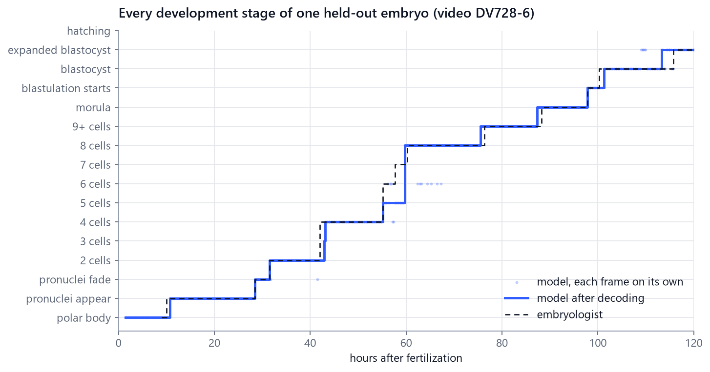

# Embryo Scan

AI that watches 5-day IVF embryo time-lapse videos, detects every cell division, ranks embryos by predicted viability, and grades the resulting blastocyst like an expert embryologist.

[](https://github.com/cha205/embryo-scan/actions/workflows/ci.yml)

> Status: models trained and evaluated on held-out patients (every number below is a test-set result). The demo app runs locally (see [Run it](#run-it)); demo GIF and public release next.



## What it does
1. **Detects every cell division in a time-lapse video.** A model labels the development stage of every frame (2 cells, 3 cells, ... blastocyst), then a dynamic program finds the most likely sequence that never goes backwards, which gives each division's time in hours.
2. **Ranks embryos by viability from their first three days.** Division timings up to day 3 predict which embryos will form a blastocyst by day 5, the standard viability proxy in time-lapse research.
3. **Grades the blastocyst.** A second model grades day-5 photos on the Gardner scale (expansion, inner cell mass, trophectoderm), benchmarked against a panel of embryologists.
4. **Measures what deep learning adds.** A classical image-processing pipeline in MATLAB, with no machine learning, times the same divisions on the same videos as a baseline.
5. **Shows its work.** A Three.js app replays a real video next to a 3D "digital twin" that divides at the detected times, and grades any day-5 photo you upload, with heat maps of what the model looked at.

## Results

### Division detection
141 test videos from 108 patients the model never saw, 59k labelled frames:
- Development stage of each frame: **71.8%** exactly right, **92.8%** within one stage (16 stages), after the never-go-backwards decoding (69.7% before it).
- Division times vs the embryologist's marks: median error **1.0 h** across all divisions (frames are 15 min apart).

| Division | 2 cells | 3 cells | 4 cells | 5 cells | 8 cells | morula | blastocyst |
|---|---|---|---|---|---|---|---|
| Median error (h) | 0.2 | 0.3 | 0.5 | 1.0 | 1.7 | 1.7 | 1.1 |
| Within 2 h | 94% | 84% | 87% | 70% | 56% | 56% | 68% |

Late stages are harder because cells overlap and get hard to count, for people too. Full table: [divisions-test.md](reports/timelapse/divisions-test.md); error spread per division: [figure](reports/figures/timelapse-timing-errors.png).

### Deep learning vs classical image processing
The classical pipeline finds the embryo with a circular Hough transform, measures how much it changes between frames, and turns motion spikes into division times with rules from embryology. Its rules were checked on validation videos only, then run once on the same 141 test videos and scored the same way:

| Videos timed within 1 h of the embryologist | 2 cells | 3 cells | 4 cells | 5 cells |
|---|---|---|---|---|
| Classical image processing (MATLAB) | 44% | 34% | 45% | 22% |
| **Deep model (ResNet-34)** | **92%** | **78%** | **76%** | **57%** |

A motion detector also fires when cells shift or the embryo drifts; the network learned what a division itself looks like. Details and figures: [classical-baseline-test.md](reports/timelapse/classical-baseline-test.md), code: [matlab/](matlab).

### Viability ranking from day 0-3 timings
Will the embryo form a blastocyst by day 5? 97 test videos recorded that long; AUC with 95% CI (0.5 = coin flip):

| Timings from | Ranking method | AUC |
|---|---|---|
| Embryologist's annotations | Published Meseguer 2011 categories (no training) | 0.68 (0.55-0.78) |
| Embryologist's annotations | Logistic regression on timings | 0.72 (0.61-0.81) |
| **AI-detected from the raw video (end to end)** | Logistic regression on timings | **0.69** (0.57-0.79) |
| AI-detected from the raw video | Published Meseguer 2011 categories | 0.61 (0.48-0.73) |

From raw video alone, the AI ranks embryos nearly as well as rankings built on an embryologist's hand annotations. The strongest signals are the length of the second cell cycle (cc2) and direct cleavage (1 -> 3 cells in under 5 h), both known warning signs in the literature. Details: [viability.md](reports/timelapse/viability.md), [ROC curves](reports/figures/timelapse-viability-roc.png).

### Grading vs experts
300-photo gold test set graded by a panel of embryologists; accuracy:

| | Expansion | Inner cell mass | Trophectoderm |
|---|---|---|---|
| Individual experts (paper) | 0.78 | 0.74 | 0.70 |
| Best published model (paper) | 0.85 | 0.69 | 0.62 |
| **Embryo Scan, 5-model ensemble** | **0.853** (0.81-0.89) | **0.714** (0.66-0.77) | **0.660** (0.60-0.72) |
| Embryo Scan, balanced thresholds | 0.853 | 0.697 | 0.672 |

Our evaluation code reproduces the paper's published XCeption numbers exactly (0.78 / 0.69 / 0.62) before scoring our own model. The test set was drawn by image, so 30% of training photos come from test-set patients; retraining without them changes accuracy by less than 0.01 against a size-matched control ([patient-overlap-check.md](reports/blastocyst/patient-overlap-check.md)), so the overlap doesn't inflate these numbers. The model's tendency to call grade-B inner cell masses "A" is inherited from the single embryologist who labeled its training data (they do the same on the test set); its weakness on rare grade-C trophectoderm is its own, and balanced decision thresholds tuned on training data raise grade-C recall from 3/30 to 12/30. Details: [grading.md](reports/blastocyst/grading.md), [figure](reports/figures/blastocyst-grading-vs-experts.png).

### Live birth from a photo + clinical data
603 transferred embryos with known outcomes, patient-level CV: age alone AUC 0.53, embryologist's grade 0.55, AI grade 0.56, fine-tuned network 0.54. In this clinic's data live birth is barely predictable from any of them, and the project reports that rather than overclaiming. Details: [outcome-live-birth.md](reports/blastocyst/outcome-live-birth.md).

## Tech stack
| Area | Tools |
|---|---|
| Deep learning | PyTorch (CUDA, mixed precision, GPU-side augmentation), timm (ConvNeXt-Tiny, ResNet-34), Grad-CAM |
| Classical image processing | MATLAB R2024a with the Image Processing Toolbox (Hough transform, filtering, peak detection) |
| Data and statistics | pandas, NumPy, SciPy, scikit-learn, LightGBM; patient-level splits and bootstrap confidence intervals |
| Images, video and figures | OpenCV (WebM export), Pillow, matplotlib, Jupyter |
| App | Three.js (WebGL, custom GLSL shaders), Vite, FastAPI |
| Engineering | pytest, MATLAB unit tests, ruff, GitHub Actions CI, uv |

## Data
- **Time-lapse videos:** Gomez et al. 2022, *A time-lapse embryo dataset for morphokinetic parameter prediction*, Data in Brief. 704 videos (311k frames, one every ~15 min for up to 5-6 days) with 16 phase annotations per video, frame timestamps and blastocyst grades for 160 videos. [Zenodo 10.5281/zenodo.7912264](https://doi.org/10.5281/zenodo.7912264), CC BY-NC-SA 4.0.
- **Blastocyst photos with outcomes:** Kromp et al. 2023, Scientific Data. 2,344 day-5 photos, 300 graded by an expert panel, 754 transferred embryos with live-birth outcomes. [figshare 10.6084/m9.figshare.20123153.v3](https://doi.org/10.6084/m9.figshare.20123153.v3), CC BY 4.0.

Data problems found and fixed along the way: spreadsheet-mangled hormone values (`1.26` stored as `Jän.26`), inconsistent file names, a test set split by image rather than patient, truncated JPEGs and timestamps rounded so neighbouring frames share one, and skipped division phases that broke a published scoring rule until handled correctly. A tour of the video data: [timelapse-data-tour.ipynb](notebooks/timelapse-data-tour.ipynb).

## How it works
- **Division model:** ResNet-34 on a 3-frame stack (45 minutes before, now, 45 minutes after) so it can see cells mid-division; GPU augmentation (any rotation, flips, zoom, lighting); patient-level train/val/test split; monotonic dynamic-programming decoding.
- **Viability ranking:** division times up to 72 h -> logistic regression, compared with the published Meseguer 2011 hierarchy.
- **Grading model:** ConvNeXt-Tiny with three heads, 5-fold cross-fitting (every photo graded by a model that never saw it), test-time augmentation over 8 rotations/flips, Grad-CAM heat maps.
- **Classical baseline:** circular Hough transform to find the embryo, frame-to-frame motion energy inside it, spike detection and embryology rules for t2-t5 ([matlab/README.md](matlab/README.md)).
- **App:** Vite + Three.js front end; a FastAPI endpoint ([server/main.py](server/main.py)) grades uploaded photos with the 5-model ensemble and Grad-CAM, center-cropping other shapes to 4:3 so embryos aren't stretched.


## Repository layout
```
embryoscan/   Python library: blastocyst/, timelapse/, common/ (paths.py defines every file location)
scripts/      one command per step: blastocyst/, timelapse/
matlab/       classical image-processing baseline
server/       FastAPI grading endpoint
web/          Three.js app and design prototypes
tests/        python/ (pytest) and matlab/ (matlab.unittest)
notebooks/    data exploration
reports/      results and figures, all written by the scripts
splits/       frozen patient-level train/val/test splits
docs/         plan, explainer, pitch notes, project structure
```
Downloads (`data/`) and trained models (`runs/`) are rebuilt by the scripts and not committed. Naming rules and where new files go: [docs/project-structure.md](docs/project-structure.md).

## Run it
```bash
python -m venv .venv && .venv\Scripts\activate          # Windows
pip install -r requirements.txt && pip install -e .

# Time-lapse videos (12 GB) -> division model -> viability
python scripts/timelapse/download_data.py --delete-archives
python scripts/timelapse/prepare_data.py
python scripts/timelapse/train_stages.py                      # ~80 min on an RTX 2060
python scripts/timelapse/train_stages.py --eval-only --split test
python scripts/timelapse/run_viability.py
python scripts/timelapse/plot_divisions.py

# Blastocyst photos (624 MB) -> grading model
python scripts/blastocyst/download_data.py
python scripts/blastocyst/prepare_data.py
python scripts/blastocyst/train_grader.py                     # ~35 min
python scripts/blastocyst/report_grading.py

# Classical baseline (MATLAB) and tests
matlab -batch "addpath('matlab'); runClassicalBaseline"
pytest
matlab -batch "assertSuccess(runtests('tests/matlab'))"

# App: http://localhost:5173 (the grading server is only needed to upload your own photo)
uvicorn server.main:app --port 8000
cd web && npm install && npm run dev
```
Every script takes `--help`. The live-birth analyses are `scripts/blastocyst/run_baselines.py`, `run_outcome_models.py` and `finetune_outcome.py`.

## Limitations
- The video dataset has no pregnancy outcomes, so viability means blastocyst formation by day 5, not pregnancy.
- Each dataset comes from a single clinic; results may not transfer to other clinics, microscopes or labeling styles.
- The 3D embryo is an illustration driven by detected timings, not a reconstruction of the cells.
- Research project, not a medical device.

## Plan and log

