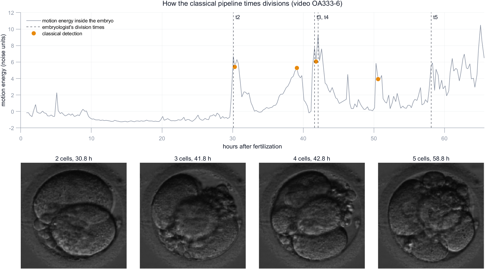
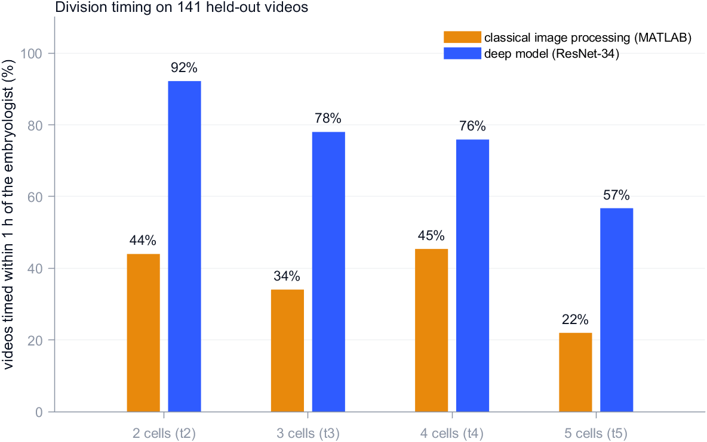

# Classical baseline: division timing without machine learning

The same 141 held-out test videos as [divisions-test.md](divisions-test.md), timed by a hand-built MATLAB pipeline (Image Processing Toolbox, nothing trained) instead of the deep model. Code: [matlab/](../../matlab).

1. **Find the embryo**: circular Hough transform (`imfindcircles`) on the median of the first 20 frames found it in 134 of 141 videos; in the rest, the most textured region (cells are grainy, the culture medium is smooth) stood in.
2. **Motion energy**: the mean change between consecutive frames inside the embryo, in units of the video's own noise. A cell splitting in two changes many pixels at once, so divisions show up as spikes.
3. **Rules from embryology**: t2 is the biggest spike between 18 and 38 h, t3 the first spike 5 to 18 h later, t4 a spike within 4 h of t3 (none means both cells split together), t5 the first spike 6 to 20 h after t4.

Timing error per division (detected minus the embryologist's time). A division a method missed counts as a miss in the within-1 h and within-2 h columns; median errors are over the divisions it found. The deep model's numbers are recomputed from its saved predictions with the same rules.

| division | videos | found by classical | median error, classical | median error, deep | within 1 h, classical | within 1 h, deep | within 2 h, classical | within 2 h, deep |
|---|---|---|---|---|---|---|---|---|
| t2 | 141 | 94% | 1.50 h | 0.20 h | 44% | 92% | 51% | 94% |
| t3 | 141 | 92% | 3.05 h | 0.30 h | 34% | 78% | 43% | 84% |
| t4 | 141 | 92% | 1.30 h | 0.50 h | 45% | 76% | 50% | 87% |
| t5 | 141 | 82% | 3.70 h | 1.00 h | 22% | 57% | 33% | 70% |

- **Meseguer 2011 category** (A+ ... D-) matches the one from the embryologist's times for 25% of 130 videos with the classical times and 47% of 141 with the deep model's.

